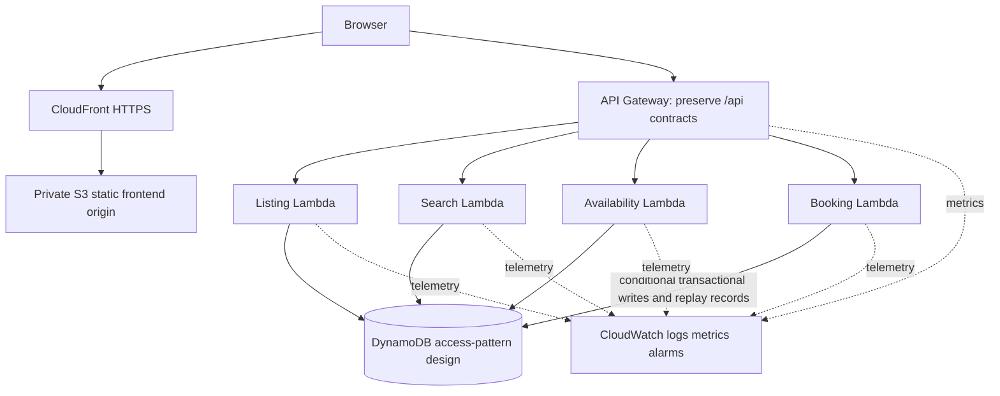
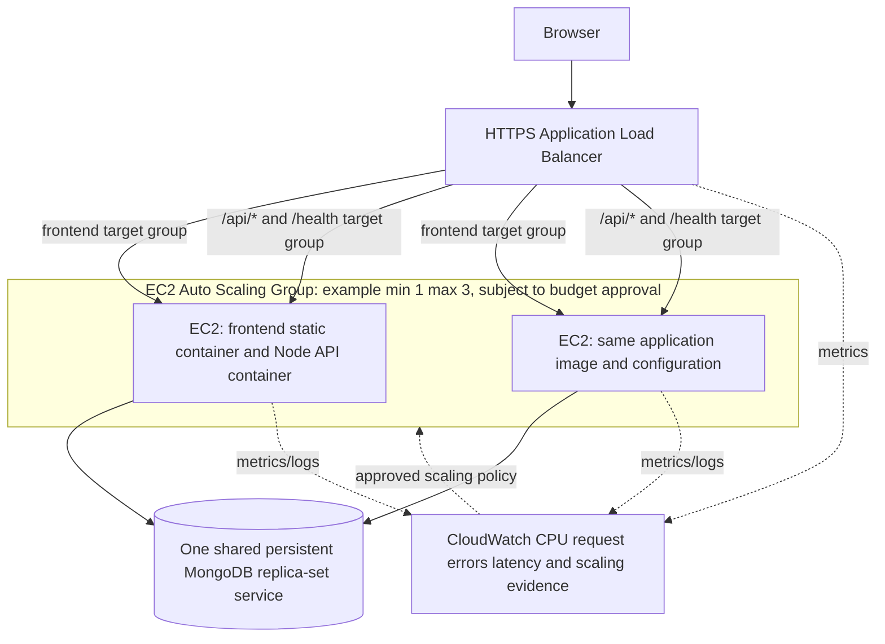

# IT457 Group 43 — AWS architecture comparison

**Date:** 16 November 2026, Asia/Calcutta  
**Decision status:** Option B approved by the user on 16 November 2026. This comparison records the decision basis; implementation details are in `CLOUD_ARCHITECTURE.md`. No chargeable AWS infrastructure has been provisioned and no DynamoDB migration performed.  
**Audit basis:** [PROJECT_AUDIT.md](PROJECT_AUDIT.md), main `4b9f595`; Member 3 prototype `52bcca1`.

## 1. Decision and research alignment

**Recommend Option B — Docker on EC2 behind an Application Load Balancer and EC2 Auto Scaling Group, with shared persistent MongoDB and CloudWatch — as the primary path for this existing implementation.** It preserves the tested Node.js/MongoDB application and API, and permits a clear before/during/after holiday-spike scaling demonstration without first rebuilding the database layer.

This recommendation is an **explicit proposed change from the original serverless architecture stated in the project brief**, not permission already granted. The research goals remain four logical service responsibilities, simulated holiday demand, booking correctness, measured latency/throughput/errors, observability and affordable operation. If API Gateway + Lambda + DynamoDB is a mandatory grading requirement, choose Option A instead and approve the migration work in section 4. We must not relabel an EC2 deployment as fulfilment of a mandatory serverless rubric.

The available Week 1 summary supports comparing cost-conscious hosting approaches and truthful evidence; the current brief explicitly names the initial serverless proposal. Neither implies that a Python rewrite, DynamoDB migration or independent microservice split is already approved.

## 2. Mandatory comparison

| Criterion | Option A: API Gateway + Lambda + DynamoDB + S3/CloudFront + CloudWatch | Option B: Docker + EC2 + ALB + ASG + shared MongoDB + CloudWatch |
|---|---|---|
| Existing Node.js compatibility | Node.js logic can be retained, but Express entry/HTTP handling needs a Lambda adapter or service handlers. A single wrapped Express Lambda would still be one deployable, not four independently scaled services. | Existing Express server can run in a container with its current routes and process lifecycle. |
| Existing MongoDB compatibility | The specified DynamoDB option replaces Mongoose models, queries, indexes and persistence behaviour. Keeping MongoDB behind Lambda is another architecture, not completion of this Option A definition. | Retains Mongoose and MongoDB. Shared persistent topology, pool limits, backups and transaction support must be decided. |
| Four logical services | Can map to separate Lambda deployments and route groups after interface/data-model work; requires tests of genuine boundaries. | Retains four modules in one container. ASG scales the **whole backend**, not each service. A later four-process split is additional scope. |
| Ease of implementation now | Higher: handler integration, database redesign, response compatibility, search/filter support, workflow restoration and failure/retry tests. | Lower relative change: container packaging, process supervision, networking, deployment automation and scaling configuration; still substantial work. |
| Simulated holiday scaling | Managed function concurrency and DynamoDB capacity can respond to demand, subject to quotas, throttling, hot-key behaviour and initialization. Does not remove contention on a popular property. | CPU/request-based ASG scaling can demonstrate scale-out/recovery. Instance launch, image pull, health checks and warmup cause delay; the shared DB can bottleneck. |
| Performance measurement | k6 end-to-end timing plus API Gateway/Lambda/DynamoDB metrics; distinguish cold/warm starts, throttles, conflicts and database latency. | k6 timing plus ALB request/target/error metrics, EC2 CPU, ASG desired/in-service counts and shared DB telemetry; distinguish warmup from capacity. |
| Cost | Usage-driven requests/duration, gateway, database read/write/storage, CDN and logs. Potentially attractive for short idle-heavy demos; migrations and high transaction/scan volume can add effort and cost. | EC2, ALB, storage and database have a running baseline; peak instances add cost. Short bounded demonstration windows are important. Not assumed cheaper than A. |
| Complexity | More managed infrastructure operation, but more application/data redesign for this repo; distributed retries/permissions and contracts still need careful work. | Less application migration, more host/container/patching/network/security-group/ASG operational responsibility. |
| Academic demonstration | Closest to original proposal; useful independent function/concurrency and DynamoDB transaction evidence once complete. | Most direct route from the existing working code to an observable ALB/ASG experiment; accurately present logical SOA in one scaled deployable. |
| Existing code reused | Frontend largely reusable only if contracts stay exact; service algorithms/validators reusable in part. Mongoose persistence/search and tests need adaptation. Member 3's Python prototype is incomplete. | Most frontend, REST APIs, service code, MongoDB schemas and functional tests retained. Idempotency and failure-recovery changes are required in either option. |
| Security/durability | IAM and least privilege, API auth, secret handling, transaction conditions and safe table retention required. Current prototype's wildcard CORS and Delete policies are not a final design. | Private backend/DB access, TLS at ALB, instance role, secret delivery, backups, patching and shared DB credentials required. Do not put DB inside disposable ASG nodes. |

The relative effort judgements are based on the inspected repository, not benchmark results. No reuse percentage, implementation date or monetary saving has been invented.

## 3. Proposed architecture diagrams — neither is deployed by this audit

### Option A: original serverless direction



This is a proposed separation; actual service-to-service API interfaces and shared/read ownership must be specified before coding. The diagram does not claim current handlers or the Python prototype already meet these contracts. DynamoDB search must be designed from supported filter/sort patterns, not assumed to reproduce MongoDB regex queries efficiently.

### Option B: recommended preservation path



The suggested instance-count range is a **planning example**, not a deployed resource count or approved spend. The database must live outside the ASG lifecycle; a suitable managed MongoDB service or a separately operated persistent replica set needs explicit budget/security review. A one-node replica set can support transaction testing but is not high availability. Amazon DocumentDB is not silently substituted for MongoDB; compatibility and costs require a separate assessment.

For an economical first B design, serve the built frontend and API from the same public origin through separate ALB target groups and explicit path rules, avoiding an extra static-hosting stack initially. The frontend still needs its public API origin at build time, TLS, correct CORS and preserved `/api/*` routing. S3/CloudFront can be added if approved; it is not necessary to invent another mandatory service for Option B. No Vite development server should be exposed as production hosting.

The ASG copies the same four-module backend to each node. A module is not an independently deployed microservice merely because multiple backend replicas exist.

## 4. Migration effort and risks before approving Option A

Node.js Lambda functions are possible; the current Python prototype does **not** force a language rewrite. Nevertheless, the requested DynamoDB stack entails these changes:

| Work package | Required change and acceptance evidence |
|---|---|
| API compatibility | Preserve paths, camelCase fields, listing IDs or a deliberate migration map, response/error envelopes, pagination, PATCH, Authorization and future idempotency headers. Run existing frontend contract tests. |
| Listing storage | Replace Mongoose persistence; migrate/import the 20 seed records and future records without losing city/country, type, amenities, capacity and photo fields; retain listing publication. |
| Search design | Specify DynamoDB key/index access patterns for current filters/sorts and date exclusion. Bound scans explicitly if used for a small academic dataset; measure their cost and latency. Do not claim an unbounded scan is an optimised search service. |
| Booking correctness | Transactionally bind booking, per-night conditions and idempotency state. Persist replay outcome and compare request fingerprint. Define safe cancellation and failed-request recovery. |
| Application workflow | Implement booking retrieval, cancellation, active date ranges and manager operations absent from the prototype; preserve Pending/Confirmed/Cancelled behaviour. |
| Integration/deployment | Package handlers, explicit service interfaces, IAM, CORS, API mapping, secrets, health/readiness, retention and monitoring. |
| Test migration | Replace MongoDB-specific fixtures/assertions; retain browser/contract tests; add DynamoDB transaction, lost-response replay, unprocessed-read, throttle and cancellation tests. |

Member 3's conditional transactional puts are a useful starting point. However, the handler generates a fresh UUID per attempt and does not retain an application idempotency record. Availability does not handle DynamoDB unprocessed read keys. Its four hard-coded listings and incompatible endpoints mean that merging and switching the API URL would regress the current website.

DynamoDB supports all-or-nothing transactions and request tokens, but API-level replay, fingerprint checks and retention must be designed beyond a transient client-token window. Transactional operations also have capacity/cost implications. [DynamoDB transactions](https://docs.aws.amazon.com/amazondynamodb/latest/developerguide/transaction-apis.html).

**Approval required:** accept database migration, data mapping, API preservation plan, handler/service deployment granularity, migration/testing effort and an AWS budget. Approval for this comparison is not approval to migrate or deploy.

## 5. Work still required if Option B is approved

1. Keep the current Node.js, MongoDB and frontend contracts. Fix audit findings A01–A03 before claiming reliable retries or failure-safe scaled writes.
2. Choose transaction-capable persistent MongoDB topology or an explicitly recoverable alternative. Verify unique indexes and bounded connection pools for multiple API replicas. Use database coordination, not process-local locks.
3. Create reviewed backend/frontend container definitions, build ignores, local Compose, non-root runtime where feasible, health checks and persistence configuration. Test `docker compose up --build` after enabling Docker's engine. No files exist for this yet.
4. Prepare a launch template, reproducible image/artifact delivery and ASG with strict maximum capacity. A restart policy must keep application containers running; instances must not reseed/reset the shared database.
5. Use ALB routing and health checks, proper security groups and HTTPS; choose shared secret delivery without putting credentials in images or frontend builds.
6. Configure CPU target tracking, instance warmup and bounded scale-in. Validate whether CPU or requests per target actually correlates with this workload; database-bound latency may rise without high CPU. A starting CPU target is a hypothesis to calibrate, not a performance promise.
7. Collect actual CloudWatch and k6 evidence before claiming holiday-spike handling. Test multiple instances against the same property/dates, cancel/retry failures, instance termination and recovered capacity.

EC2 target tracking uses a selected utilisation/throughput target and manages related CloudWatch alarms; scale-out is not instantaneous. This capability exists in AWS, **not yet in this repository's deployment**. [EC2 target tracking](https://docs.aws.amazon.com/autoscaling/ec2/userguide/as-scaling-target-tracking.html).

## 6. Measurement plan relevant to either choice

This is a requirements plan, not the Phase 8 implementation or a claim of measured AWS performance.

| Evidence | A | B |
|---|---|---|
| End-to-end latency, p95/p99, request rate and failure counts | k6 client observations | k6 client observations |
| Infrastructure latency/errors | API Gateway, Lambda and DynamoDB telemetry | ALB target response time, target/ALB errors and application durations |
| Capacity and scaling | Lambda concurrent executions/throttles; DynamoDB capacity/throttles | EC2 CPU, ASG in-service/desired counts, scaling activities and warmup times |
| Business correctness | Booking/replay/conflict/cancellation metrics and database assertions | Same, including across multiple API processes |
| Durability | Transactional and restart/failure assertions | Transactional/recovery and instance/database failure assertions |
| Scenario comparison | Normal, weekend, holiday, extreme, recovery against owned test deployment | Same |

Use controlled data and timestamps common to generator and CloudWatch. Separate expected 409 conflicts from unexpected booking failures; record them rather than disguising either. Do not average per-instance p99 values to invent a fleet percentile. Generator saturation/dropped work and cold-start/warmup intervals need separate reporting.

ALB `TargetResponseTime` measures the target response-header interval, not the full browser journey. Compare it with client-side timings using that distinction. [ALB metric definitions](https://docs.aws.amazon.com/elasticloadbalancing/latest/application/load-balancer-cloudwatch-metrics.html). Lambda scaling is bounded by concurrency/scaling limits and can throttle; a serverless design does not establish unlimited instantaneous holiday capacity. [Lambda scaling behaviour](https://docs.aws.amazon.com/lambda/latest/dg/scaling-behavior.html).

## 7. Cost comparison without invented savings

No AWS account, region, instance size, hours, request volume or credit eligibility has been approved. Consequently there is **no defensible dollar total or cheaper-option guarantee yet**. An Indian deployment region can be considered, but it must be selected with the team and priced explicitly.

| Cost component | A | B |
|---|---|---|
| Compute | Lambda requests and duration; optional concurrency features if chosen | EC2 instance-hours, including added ASG capacity and runtime supervision |
| API entry | API Gateway requests/data | ALB running hours and capacity usage |
| Data | DynamoDB read/write/storage, transaction costs and backups | Persistent MongoDB provider/instances, storage and backups; shared tiers can distort load tests |
| Frontend/network | S3, CloudFront, transfer and logs | Frontend/container delivery plus ALB/data transfer; optional S3/CDN only if selected |
| Operations | CloudWatch logs/metrics/alarms and applicable networking | CloudWatch, EBS, public IPv4 and applicable network/NAT services |

For a brief idle-heavy demonstration, A may have less continuously running infrastructure expense. B minimises current code migration but incurs running infrastructure cost. These are workload-based expectations, not measured cost results. Free credits do not prove zero cost; a budget alert is not an automatic spending stop.

After architecture approval, prepare a region-specific estimate from actual chosen quantities; request separate approval before creation, cap resources, limit retention and define cleanup/data retention. Do not put durable database deletion into a generic cleanup command.

Pricing references checked for this comparison on 16 November 2026:

- [AWS Lambda pricing](https://aws.amazon.com/lambda/pricing/).
- [API Gateway pricing](https://aws.amazon.com/api-gateway/pricing/).
- [DynamoDB pricing](https://aws.amazon.com/dynamodb/pricing/).
- [EC2 on-demand pricing](https://aws.amazon.com/ec2/pricing/on-demand/).
- [Elastic Load Balancing pricing](https://aws.amazon.com/elasticloadbalancing/pricing/).

## 8. Review commands and approval checkpoint

These are read-only checks or existing test/build commands, not infrastructure creation instructions:

```powershell
Set-Location 'C:\Users\HP\OneDrive\Desktop\airbnb-cloud-project\airbnb-cloud-project'
git status --short --branch
git rev-parse HEAD
git show origin/member-3:member3-prototype/deployment/template.yaml
docker --version
docker compose version
# This reports engine availability; the audit found the Linux engine unavailable.
docker info --format '{{.ServerVersion}}'
Set-Location frontend
npm.cmd run build
```

No `aws deploy`, `sam deploy`, `terraform apply`, paid-resource creation, database migration or prototype merge was performed. Docker/load/AWS implementation and the remaining final deliverables are intentionally deferred.

**Decision recorded:** the user approved Option B and implementation. If independently deployed service-to-service APIs are mandatory in the rubric, that still needs separate scope confirmation; this implementation remains four logical modules. **Architecture approval alone does not authorise chargeable AWS resources.**
