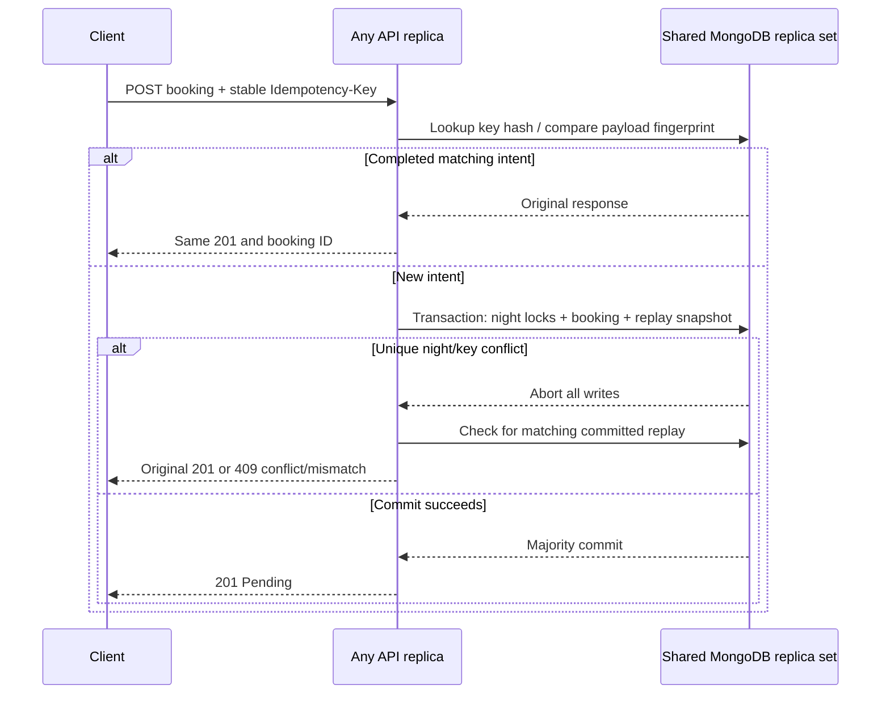

# Booking concurrency and retry correctness

## Invariants

1. Unique `{ listingId, night }` permits at most one active owner per night; check-out is exclusive.
2. Booking creation commits night locks, Booking document, request fingerprint and original POST response in **one MongoDB transaction**. Failure rolls back every write.
3. Cancellation commits status and lock deletion together. Failure leaves the previous state intact; repeated successful cancellation returns 200 and remains Cancelled. It never reconfirms a cancelled booking.
4. `Idempotency-Key` optionally identifies a POST intent for backwards-compatible callers. The actual frontend supplies it. Keys contain 8–128 allowed ASCII characters. The backend stores SHA-256 key hashes, a normalized payload fingerprint and original response under a sparse unique index.
5. Same key/same normalized payload returns the original 201 response, including across instances. Same key/different payload returns 409 `IDEMPOTENCY_MISMATCH`. Different keys for occupied dates return 409 `BOOKING_CONFLICT`.

Replay preserves the **original POST result**, even after cancellation or a price change; GET `/api/bookings/:id` shows current state. Replay records have no TTL that could accidentally permit a late duplicate intent. They remain with the booking. This costs storage and needs a deliberate future retention policy. Request keys are not authentication and must not be shared.



## Retry rules

The frontend retains a random key per one-way payload digest in session storage; no guest text is persisted. Same payload in the same tab, including reload, reuses its key. A changed payload gets a new key. With a key, booking retries at most twice after the first attempt on network/429/502/503/504 failures, using bounded exponential delay and jitter. Validation, conflict and fingerprint mismatch are not retried. No-key writes are never automatically retried. Per-attempt client timeout remains 15 seconds.

The MongoDB driver's `withTransaction` handles transient transaction/commit retries with a bounded timeout. There is deliberately no standalone-database fallback. This is MongoDB coordination, not an in-memory mutex. All replicas need the same database and indexes. Existing standalone users must move to the supplied replica-set dev setup or their chosen persistent replica set; there is no database-engine migration.

## Tests

Frontend retries reuse the identical key and body, with bounded exponential backoff for network failures, 429 and 502/503/504. Numeric Retry-After is respected; delays above three seconds stop automatic retry so the user can retry later. Validation failures and booking conflicts are not automatically retried.

```powershell
Set-Location backend
npm.cmd run test:isolated -- --coverage
# Docker dedicated load stack only:
docker compose -p airbnb-loadtest -f ../docker-compose.yml -f ../performance/compose.load.yaml exec backend node scripts/check-multiple-instances.cjs
```

Automated coverage includes 15 concurrent distinct requests for identical dates; partial overlaps; adjacent stays; ten simultaneous identical keys; payload mismatch; original replay after cancellation; injected insert failure; injected night-release failure; repeat-safe cancellation; second-client isolation from uncommitted locks; and independent application instances. The dedicated process probe starts **two real Node processes**, sends 20 competing requests, replays through the other process, terminates the creator and cancels through the survivor. It does not pretend these local processes are AWS instances.

Startup waits for the unique indexes and transaction-capable topology before serving. Old corrupted/orphan reservation data is not automatically deleted; inspect it in a backed-up maintenance window. Successful repeated cancellation can repair that booking's legacy locks, but a broader orphan repair job requires explicit policy and review.

The four logical service responsibilities remain unchanged. Publishing and reference-based guest lookup/cancellation remain academic-demo interfaces; these correctness measures are not a replacement for guest/host authorization or payments.
