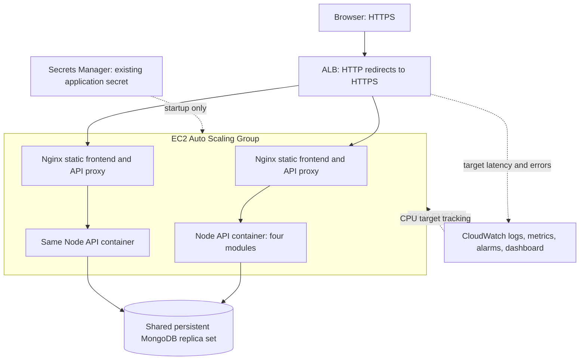

# Option B cloud architecture

Option B was approved on 16 November 2026. It preserves the Node.js/Express/Mongoose application, MongoDB and frontend API contracts. It does **not** implement four independently deployed microservices: Listing, Search, Availability and Booking are logical service modules in each backend replica. Internal calls remain JavaScript interfaces; external interfaces remain the documented REST routes. No DynamoDB migration or Python prototype merge is required.

The concrete template uses **one ALB target group on port 8080**, rather than the comparison's illustrative pair of target groups. Each instance's Nginx serves static assets and proxies `/api/*` and `/health` to its local backend container. This keeps one public origin, preserves routes, and avoids frontend localhost configuration. Both images are pinned by digest for AWS; the frontend is compiled with `VITE_API_URL=/`.

## Runtime and state

- Backend/booking runtime: Node 22; startup waits for indexes and refuses standalone MongoDB because booking/cancellation use transactions.
- Three collections: listings, bookings and unique per-night reservations. Idempotency hashes/fingerprints/original creation responses are fields on Booking, indexed uniquely when present.
- Every replica must use the **same** persistent database and manager code. No instance-local booking state or file locks coordinate correctness.
- MongoDB is not hosted inside the ASG. EC2 termination does not delete database records. Managed MongoDB/private connectivity or a separately managed persistent replica set is a prerequisite, not a resource secretly provisioned by the template.
- A local single-node replica set supports transaction testing; it is not a high-availability database. Production resilience needs the chosen provider's actual topology, backups and restore verification.
- Pending requests reserve nights until a manager acts or a guest cancels. Automatic expiry remains outside this implementation.

## Scaling configuration

`infra/option-b.json` defines ALB, security groups, instance role/profile, launch template, ASG, CPU target tracking, metrics, alarms, log retention and dashboard. Default desired/minimum is 1, maximum 3 (configurable 1–5). CPU target defaults to 60%; warmup 180 seconds, ELB grace 300 seconds. These are initial settings to calibrate, not measured optimums. One instance is not high availability; rolling updates permit temporary reduced availability to keep the academic deployment bounded.

CPU-based scale-out cannot repair a slow database. Record DB connection limits and latency, inspect query plans, and distinguish launch/warmup delay from steady-state capacity. Bound maximum capacity before a test. All instances use the same application image/configuration; the system scales the whole modular backend, not individual services.

## Monitoring

The API emits CloudWatch Embedded Metric Format only when `METRICS_ENABLED=true`. Bounded dimensions are `Environment` and `Service`; no booking IDs, emails, request keys, URLs or guest bodies are dimensions/logged by this middleware. Health polling is excluded. Metrics include duration, requests, HTTP 5xx/client errors, booking attempts, expected booking conflicts and unexpected booking failures. Conflicts are not silently counted as unexpected failures.

Docker's AWS log driver sends these events to the template's log group. CloudWatch must actually receive them before a dashboard can be claimed populated. ALB target latency and client/k6 timing measure different intervals. `scripts/aws/collect-evidence.ps1` exports **actual** cloud observations and scaling activities after deployment; it refuses to replace missing observations with zeroes.

## Security and deployment status

TLS certificate and an existing VPC/subnet layout are required. No SSH rule is added. Application ingress is only from ALB; IMDSv2 is required; backend containers run without root/capabilities, on a private Docker network. Application secrets are retrieved into a root-only host environment file, never built into frontend assets/images. Use the default Secrets Manager managed KMS key or explicitly review additional KMS permissions for a customer-managed key.

The template uses existing public/application subnets. Public application instances have no public inbound application/SSH rule; private instances need existing egress/endpoints to reach ECR, Secrets Manager, logs and MongoDB. Database access must be deliberately restricted; do not solve connectivity by broadly opening MongoDB to the internet.

**Prepared infrastructure is not deployed infrastructure.** See `AWS_DEPLOYMENT_GUIDE.md` for the approval gate and `PERFORMANCE_ANALYSIS.md` for measured evidence and limits.
