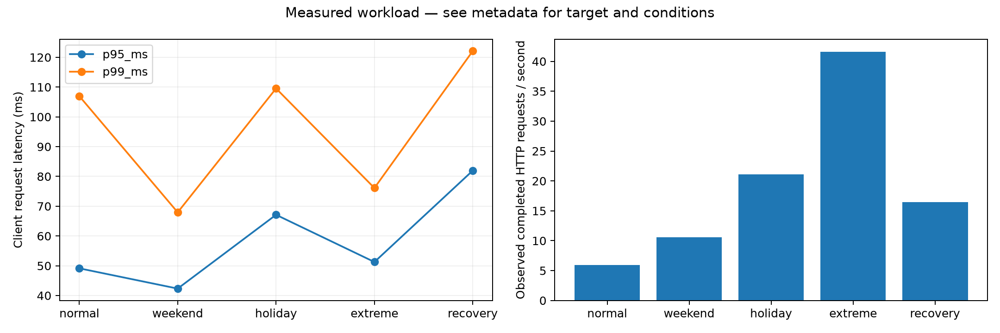
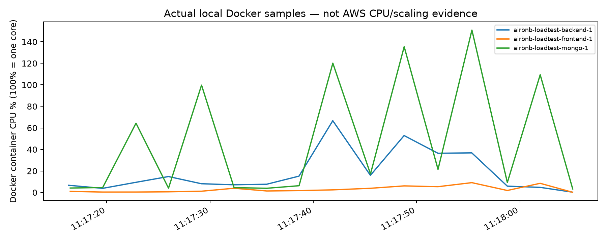

# Performance analysis and evidence status

## Scope

The workload is a simulated holiday-demand engineering scenario, not Airbnb's traffic or outage data. Option B implementation includes executable k6 scenarios, raw capture, CSV analysis and graph generation. A pushed template is not a deployed/scaled AWS system.

The Phase 1–2 audit's 100 sequential requests remain historical **audit observations**, not holiday-load results. See `PROJECT_AUDIT.md` for their conditions; do not mix them with the new k6 experiment or infer maximum throughput from them.

## Evidence classification

| Evidence | Meaning |
|---|---|
| Backend/HTTP/browser correctness tests | Functional and failure/concurrency behaviour under their test conditions |
| Local k6 observations | Actual client measurements against the stated laptop/container target and synthetic DB |
| Local Docker CPU | Container CPU sampling; 100% represents one core, not fleet CPU |
| Actual AWS evidence | Only exports from a deployed account's CloudWatch/scaling activities, with real resource IDs and timestamps |
| Not measured | No substituted zero, estimated graph or simulated AWS series |

**AWS deployment, cloud CPU/instance-count scaling evidence and cloud cost outcomes are not measured**, because chargeable resource creation was not approved. No performance or cost improvement percentage is claimed.

## Actual local verification — 16 November 2026

Backend verification passed 134 tests in nine suites (97.28% line coverage). Frontend verification passed 31 browser tests; production Docker browser verification covered search, booking, manager approval, guest status refresh and cancellation. Two separate Node processes sharing MongoDB received 20 competing requests: one booking succeeded, 19 conflicted; replay through the other process and cancellation after stopping the creator succeeded. Docker startup, persistent data after backend restart, CloudFormation lint and PowerShell syntax checks passed.

The clean Docker run used five 10-second phases, a dedicated synthetic replica-set database and local Nginx/API containers. It completed **951 HTTP requests, zero failed requests and zero dropped iterations**. Short runs establish execution correctness, not sustainable capacity.

| Phase | Observed HTTP RPS | p95 ms | p99 ms |
|---|---:|---:|---:|
| Normal | 5.925 | 49.136 | 106.956 |
| Weekend | 10.546 | 42.330 | 67.940 |
| Holiday | 21.075 | 67.116 | 109.547 |
| Extreme | 41.637 | 51.267 | 76.118 |
| Recovery | 16.476 | 81.961 | 122.118 |

Recovery includes requests from multi-operation booking iterations, so HTTP RPS need not equal the configured iteration rate. [CSV, metadata and summaries](performance/evidence/docker-50s-pass/) identify the actual conditions and images. CPU observations are local Docker measurements on a shared laptop, with unrelated workloads uncontrolled.

A separate [150-second Node/temporary-Mongo run](performance/evidence/local-150s-pass/) completed 2,875 HTTP requests with no failed requests or dropped iterations; overall p95 was 30.062 ms and p99 39.261 ms. This was not Docker or AWS. The retained [failed 300-second run](performance/evidence/local-300s-failed/) completed 5,052 HTTP requests but dropped 496 iterations and failed its threshold. Host addressing, drain settings and duration differed between runs; these observations do not prove a capacity improvement. Raw captures remain locally ignored; published SHA-256 files identify them. Metadata deliberately records the base commit and dirty working tree used during verification.

## Analysis method

The analysis script uses raw k6 point records, nearest-rank percentiles and per-phase request/error counts. Observed RPS uses the interval from the first reconstructed request start to the last completion in that phase. This differs slightly from configured phase duration, particularly at boundaries. Booking iterations make up to three HTTP operations; iteration rates are not request rates. Setup/teardown observations are separate.

Expected booking conflicts are business outcomes and are counted explicitly. Validation/server/network failures and failed replay/cancellation checks are not passed off as expected conflicts. Dropped iterations indicate missing offered work; they fail the default run. Saturation, low samples, run length, local resource contention and generator limitations must be discussed.

## AWS acceptance still required

After explicit spending approval: deploy to the agreed region with persistent shared MongoDB, verify the live frontend/API, collect normal/weekend/holiday/extreme/recovery observations and actual CloudWatch CPU, in-service instance counts, latency/errors and scaling events. Verify bookings survive instance termination and are consistent across replicas. Repeat controlled runs before concluding capacity or reporting p95/p99 gains.

An unchanged count of one EC2 instance is not proof of successful Auto Scaling; an ALB dashboard definition is not a populated dashboard. CPU policy settings are hypotheses until measured. CloudWatch target latency is not end-to-end browser latency. Do not claim independently deployed service scaling for this modular application.
