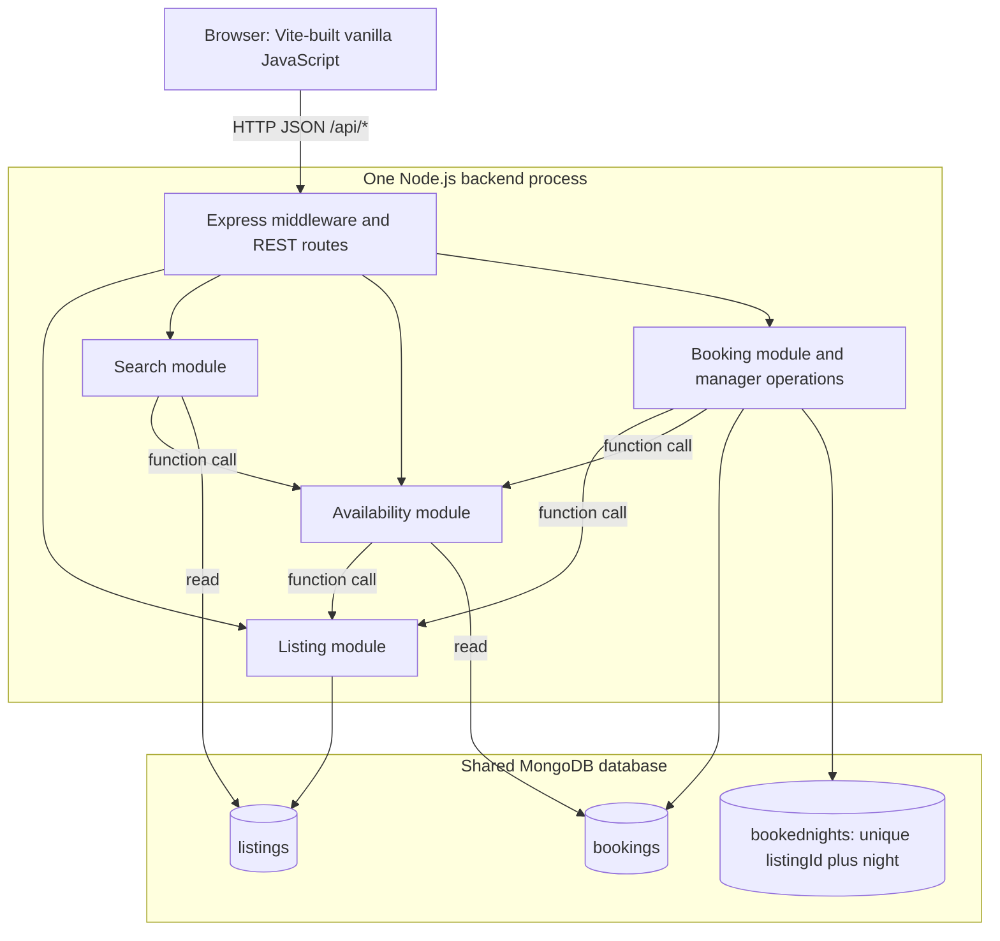

# IT457 Group 43 — Project audit

> Historical Phase 1–2 audit of `4b9f595`. Option B was subsequently approved on 16 November 2026. The implementation adds transactions, durable idempotency, safe cancellation retries, Docker, CloudFormation, monitoring and k6 tooling. Findings below remain the original audit evidence, not an assertion that addressed defects still exist. See `BOOKING_CONCURRENCY.md`, `DOCKER_SETUP.md` and `PERFORMANCE_ANALYSIS.md` for implementation and verified limits. AWS resource creation is still gated separately.

**Project:** Airbnb: Service-Oriented Architecture and Holiday Traffic Spikes  
**Audit date:** 16 November 2026, Asia/Calcutta  
**Application snapshot:** `main`, `4b9f595d95b3ad1914108951e2edaf417f00888a`  
**Member 1 reference:** `512b4a8`  
**Member 3 reference:** `origin/member-3`, `52bcca1`  
**Scope:** Phases 1–2 plus the requested architecture comparison. This is an assessment, not approval to change architecture. No application code, database schema, deployment configuration or AWS resources were changed for this audit. Proposed work below is not implemented.

## 1. Executive assessment

The repository contains a working Airbnb-inspired browser application and a tested Node.js/Express/MongoDB backend. The four services have identifiable responsibilities and public REST endpoints. They are **logical modules in one backend process**, not four independently deployed microservices. Their internal communication is by JavaScript function calls and shared MongoDB models, not network API calls.

The website is a good functional foundation, but **the complete cloud project acceptance criteria are not yet satisfied**. There is no Docker deployment in main, no verifiable AWS deployment evidence, no reproducible holiday-load framework, no measured cloud scaling history, and no CloudWatch integration in this snapshot. Booking concurrency protection works under the tested conditions, but request idempotency and failure-safe multi-document consistency are incomplete.

Primary next decision: review [ARCHITECTURE_COMPARISON.md](ARCHITECTURE_COMPARISON.md). Its recommendation is Option B to preserve the existing implementation, **subject to team/instructor approval because the original proposal in the current project brief is Option A**. No migration or replacement has been performed.

## 2. Research reference and limits

The current user brief is the controlling specification. The following project documents were read as research/context, not as instructions to execute changes:

| Reference | Evidence and scope |
|---|---|
| `C:\Users\HP\Downloads\Airbnb_Week1_Final_Summary.pdf`, two pages | Available Week 1 walkthrough/summary: SOA, traffic management, simulated holiday peaks, measured results, cost verification and four simplified services. It is outside Git; this audit does not claim a separate full research report is tracked in the repository. |
| `C:\Users\HP\Downloads\airbnb work plan (2).docx` | Member ownership, interface agreement, early integration, online application and controlled experiments. |
| `C:\Users\HP\Downloads\Airbnb_Week_by_Week_Member_Work_Plan (2).docx` | Five-week milestones; AWS choices depend on approval, pricing and eligibility; only report actual results. |
| Current user-provided research objectives | Explicitly establishes the API Gateway + Lambda + DynamoDB + static-hosting proposal, idempotency, p95/p99, concurrency and simulated spikes. These details should not be incorrectly attributed to passages absent from the available PDF. |

The simulated holiday workload is **our engineering experiment**, not evidence that Airbnb had a particular holiday API outage. Airbnb's own traffic-management article provides relevant engineering context, not measurements of this student system. No Airbnb traffic figures, savings or improvement percentages are used as our results. [Airbnb Engineering: adaptive traffic management](https://airbnb.tech/infrastructure/from-static-rate-limiting-to-adaptive-traffic-management-in-airbnbs-key-value-store/).

### Alignment with the research

| Research objective | Current evidence | Assessment |
|---|---|---|
| Four service responsibilities | Four service folders, controllers and route groups | Present as logical boundaries |
| Well-defined APIs | REST handlers, validators, standard response helpers, API documentation | Present externally; internal calls are not network APIs |
| Correct booking/availability | Indexed night reservations; status validation; integration tests | Working ordinary flows; failure-recovery gap below |
| Idempotency and safe retries | No idempotency record, key processing or replay result | Missing |
| Simulated seasonal demand | No executable k6 source in main | Missing |
| p95/p99, throughput, error rates | Small audit sample below; no holiday experiment | Project-level performance evidence missing |
| Cloud deployment and scaling | Prototype on separate branch; no verified deployment evidence | Not demonstrated |
| Affordable, evidence-based evaluation | Existing cost discussion; no verified bill or load-run evidence | Planning only |

## 3. Repository inventory and existing features

### Frontend

- Vite + vanilla JavaScript ES modules; **not React**. Entry: `frontend/src/main.js`; hash-based routes do not require a conventional SPA path rewrite.
- API client: `frontend/src/api.js`; frontend API base is built from `VITE_API_URL`, defaulting to `http://localhost:5000`.
- Dynamic listing-derived destinations, city/country suggestions, inventory pagination, dates/guests, price/type/amenity filters and sorting.
- Property details, reserved-night calendar, sample photo galleries, availability checking, booking submission, reference lookup, status refresh and cancellation.
- Booking manager at `#/manage`: private server token, pending/confirmed/cancelled views, acceptance/decline/cancellation and pagination.
- Public listing-creation form, saved property IDs, up-to-three-property comparison with clear control, printable itineraries and calendar export.
- Browser-local preferences persist across visits; homepage reload and completed-booking return reset search context. Preferences are not cloud-synchronised accounts.
- Responsive layouts, keyboard navigation, labelled forms, loading/empty/error states and automated accessibility checks.

The frontend derives facets by fetching **all inventory pages**. This is correct for the current small dataset, but grows in network and client work with catalogue size. A server-owned facets endpoint is a targeted future improvement if measurement justifies it; a new search engine or unrelated UI features are not prerequisites.

### Backend and MongoDB

- Express 5, Mongoose, CORS, Helmet, Morgan, environment configuration and central error handling.
- Collections: `listings`, `bookings`, `bookednights`. Index creation is awaited before accepting traffic (`backend/src/config/db.js`).
- Database-backed prices and totals; guest capacity, date validity and maximum 30-night stays are checked. Check-out is exclusive.
- Pending and Confirmed hold nights; Cancelled releases nights in ordinary successful execution. Pending requests have no expiry job.
- Health endpoints reflect MongoDB connection state. Startup fails if connection cannot be established; SIGTERM/SIGINT handling attempts graceful shutdown.
- Error envelopes and HTTP statuses are consistent in normal tested routes. Production error handling conceals stack traces.
- The test suite is mostly database-backed HTTP integration/functional testing with Jest/Supertest, plus unit-level helpers and browser tests. It should not all be labelled isolated unit testing.

### Four service boundaries

| Service | Implementation | Responsibility | Current dependencies |
|---|---|---|---|
| Listing | `backend/src/services/listing/listing.service.js` | Create/read listing inventory | Listing model |
| Search | `backend/src/services/search/search.service.js` | Filter/sort/paginate results; exclude booked listings when dates supplied | Direct Listing-model reads; Availability function call |
| Availability | `backend/src/services/availability/availability.service.js` | Date overlap queries and booked ranges | Direct Booking-model reads; Listing function call |
| Booking | `backend/src/services/booking/booking.service.js` | Validate capacity/price, reserve nights, store/retrieve bookings and transition status | Listing and Availability function calls; Booking and BookedNight writes |

Controllers handle HTTP adaptation. Services do not write another service's owned data, but some **read** another domain's model directly. Existing documentation's stronger implication of full storage encapsulation is not accurate for these reads. Independent service extraction would require explicit interfaces and data ownership decisions; it is not already complete.

## 4. REST API audit

Evidence: `backend/src/routes/index.js`, controllers, validators and response helpers.

| Method | Endpoint | Function | Access in this snapshot |
|---|---|---|---|
| GET | `/health`, `/api/health` | Database connection status and uptime | Public |
| GET | `/api/listings` | Paginated inventory | Public |
| POST | `/api/listings` | Create a listing | Public demo operation |
| GET | `/api/listings/:id` | Property details | Public |
| GET | `/api/search` | Filtered results and pagination | Public |
| GET | `/api/availability` | Availability for listing/date range | Public |
| GET | `/api/availability/:listingId/bookings` | Active date ranges without guest details | Public |
| POST | `/api/bookings` | Create Pending booking and reserve nights | Public; no idempotency processing |
| GET | `/api/bookings/:id` | Reference-based lookup including guest details | Public reference |
| PATCH | `/api/bookings/:id/status` | Confirm or cancel | Confirmation requires manager token; cancellation is reference-based |
| GET | `/api/admin/bookings` | Manager booking list | Bearer token |
| PATCH | `/api/admin/bookings/:id/status` | Manager decisions | Bearer token |

Success: `{ success: true, data, meta? }`. Failure: `{ success: false, error: { code, message, details? } }`. The manager uses the Booking service; it is not a fifth independently deployed service. The router is an API entry point, **not an actual AWS API Gateway deployment**.

## 5. Actual current architecture



This is a modular application with service-oriented boundaries. It has no service discovery, service-to-service network authentication, independent process scaling or distributed tracing. None is claimed as already implemented.

## 6. Booking correctness: what works and what does not

### Working concurrency safeguard

`BookedNight` has a unique compound index on `{ listingId, night }`. Each booking attempt gets a new booking ID and claims the individual nights. Duplicate-key failures trigger cleanup of that attempt's claimed nights and a 409 conflict. An overlap precheck improves error reporting but **the database index**, not that precheck, prevents concurrent ownership of a night.

Existing tests cover 15 identical simultaneous attempts (one booking and 14 conflicts), partial overlap, non-overlapping requests, same-day turnover, cancelled dates, status transitions and server-calculated prices. Multiple processes sharing the same correctly indexed database should retain this invariant, but multi-instance deployment and failure recovery are not established by the single-process tests.

### Audit findings — left unfixed pending architecture approval

| ID | Priority | Finding | Evidence and consequence | Recommended next work |
|---|---|---|---|---|
| A01 | High | Booking creation is not idempotent | Audit probe: same payload and `Idempotency-Key` gives 201, then 409, not the original booking result. No key/schema/controller processing exists; CORS does not allow this header either. | Persistent key/result storage with payload fingerprint, concurrent-key protection, result replay and mismatch handling; retain key across client retries. |
| A02 | High | Cancellation can leave unrecoverable reserved-night locks after a database operation fails | Fault-injection probe: status update succeeds, night deletion fails, endpoint returns 500; database says Cancelled with 3 locks; retry returns 409; availability says true but rebooking returns 409. | Couple status and night release transactionally on an approved replica-set deployment, or design a durable recoverable state machine/reconciliation. Cancellation retries must be safe. |
| A03 | High | Creation is not an all-or-nothing multi-document transaction | Static inspection: ordered `insertMany` can insert some nights before another insert fails; cleanup is a separate operation, followed by a separate Booking insert. A process crash or failed cleanup can leave orphan locks. This crash window was not process-kill tested. | Make booking, nights and idempotency state one durable unit, or implement explicitly recoverable reservation states. Do not describe the current entire workflow as atomic. |
| A04 | High for online public use | Guest authorization is reference-based; listing publication is public | Routes expose guest details/cancellation to anyone with the reference; one shared token protects only management. | Restrict demonstration access and use synthetic guests. Decide minimal authorization before unrestricted public use; a full marketplace account system is outside this research scope. |
| A05 | Medium | No safe retry contract for ambiguous writes | Client timeout is 15 seconds; there is no automatic retry/backoff policy or idempotent write replay. Ordinary manual retry can hide the successful original request behind a conflict. | Implement idempotency first; then bounded exponential backoff with jitter for eligible transient failures. Do not retry validation/conflict responses blindly. |
| A06 | Medium | Hot-path work grows with inventory/bookings | Frontend fetches all inventory for facets; search uses regex filters and gathers unavailable IDs before a `$nin` listing query; manager summary lookup uses multiple queries. | Measure query plans, dataset sizes and database pools; optimise only demonstrated bottlenecks. No new database is justified solely by these observations. |
| A07 | Medium | Health and logs are insufficient observability | Health checks connection state, not write consistency. Morgan is not a latency histogram, business failure metric or CloudWatch agent. | Separate readiness and consistency checks as needed; record route/status/duration and booking outcomes, plus infrastructure metrics. Avoid guest data and unbounded booking-ID metric dimensions. |
| A08 | Medium | Runtime/deployment documentation can mislead | `backend/docs/ARCHITECTURE.md` labels frontend React; it is vanilla JS. Some legacy text implies an atomic multi-document reservation or stronger service encapsulation. `engines >=20` is broader than the frontend README's Vite runtime requirement. | Reconcile documents and pin a tested Node runtime when implementing deployment. Do not repeat old claims as verified facts. |
| A09 | Medium | Prototype is not a production-compatible deployment of main | Differences in section 8; generated build products tracked on member-3. | Preserve main, agree contracts, clean build artifacts in a reviewed change and avoid replacing APIs with the prototype. |

These findings do not negate the successful ordinary/concurrent booking tests. They identify **failure and retry behaviour that those tests did not cover**. The two audit probes intentionally assert the current deficient outcomes; their passing means the deficiencies were reproduced, not repaired.

MongoDB provides single-document atomic operations; transactions across documents require the supported replica-set/sharded deployment topology. Retaining MongoDB does not itself require a DynamoDB migration. Any deployment-topology and transaction implementation change remains subject to the next approved phase. [MongoDB transactions](https://www.mongodb.com/docs/manual/core/transactions/).

## 7. Cloud readiness, environment and Docker

| Area | Current state | Readiness judgement |
|---|---|---|
| Production frontend | `npm run build` produces `frontend/dist` | Build works; hosting not verified |
| Production backend | `npm start`; configurable port; startup DB check; graceful shutdown | Suitable foundation for containerisation, not yet containerised |
| Shared persistence | `MONGODB_URI`; indexes created on startup | Every scalable replica must use one persistent database; never an instance-local/demo DB |
| Secrets | `.env` ignored; examples tracked; no tracked `.env` found by filename check | Pattern is appropriate; no exhaustive history secret scan was performed |
| Browser configuration | `VITE_API_URL` supplied at build time | Must be public HTTPS API origin; default localhost is unsuitable on a hosted site |
| CORS | Configured exact origin list; GET/POST/PATCH/OPTIONS; Content-Type/Authorization | Set deployment origins; add idempotency header only with its actual implementation |
| Manager configuration | `ADMIN_API_TOKEN`, minimum 32 characters | Server-side secret only; same configured token on every replica; not VITE-prefixed |
| Runtime settings | `NODE_ENV`, `PORT`, `MONGODB_URI`, `MONGODB_URI_TEST`, `CORS_ORIGIN` | Existing examples reviewed; test URI must stay isolated |
| Docker files / Compose | No tracked Dockerfile, Compose file or `.dockerignore` in main | `docker compose up --build` is not currently supported |
| Docker tooling here | Docker CLI 29.8.1, Compose v5.5.1; Linux engine pipe unavailable | Engine is stopped/unreachable; no container integration verification was possible |
| Infrastructure / scaling | No main-branch IaC, ALB, launch template or ASG configuration | Missing, not deployed by this audit |
| Monitoring | Connection health + logs | No verified CloudWatch dashboard, alarms or scaling events |
| Load framework | No executable k6 framework in main; k6/AWS CLI not found on PATH | Missing; tools were not installed or infrastructure provisioned |

Static hosting must serve build artifacts, not Vite's development server. A persistent production database must replace the optional memory-server demo. Do not run the destructive seed script on a database whose records must be retained.

## 8. Member 3 branch audit

Read `origin/member-3:member3-prototype/deployment/template.yaml` and `deployment/src/app.py`, without merging them. This is an AWS SAM/Python/DynamoDB prototype, not a drop-in deployment wrapper around the existing Node/MongoDB backend.

| Contract/operational concern | main | member-3 prototype |
|---|---|---|
| Routes | `/api/listings`, `/api/search`, `/api/bookings` | `/listings`, `/search`, `/bookings` |
| Listing identity/fields | MongoDB `_id`, `title`, `pricePerNight`, city/country | Numeric `id`, `name`, `price`, location |
| Result envelope | `success`, `data`, `meta` | Bare objects/arrays; different errors |
| Input | `listingId`, `checkInDate`, `guestName`, guest count/email | `listing_id`, `check_in`, `guest_name`; different required fields |
| Inventory | MongoDB listing creation and read | Four hard-coded Python listings |
| Booking behaviour | Pending, reference retrieval, cancellation, manager confirmation | Immediately confirmed; template lacks reference GET, cancellation, listing POST, manager and calendar-range routes |
| Concurrency strategy | Unique per-night MongoDB index | DynamoDB transactional conditional puts; promising design but not proof of deployed correctness |
| Availability | Active bookings; full project response | DynamoDB batch read; unprocessed-key handling absent, so a partial read can misreport availability |
| Browser methods/headers | PATCH and Authorization supported | Template permits GET/POST/OPTIONS and content-type only |
| Idempotency | Missing | New UUID per booking attempt; no durable application idempotency/replay mapping |
| Durability on teardown | No AWS stack in main | DynamoDB `DeletionPolicy: Delete` and `UpdateReplacePolicy: Delete`; data protection decision needed |
| Source hygiene/load source | Application/test source tracked | 10,982 paths under tracked `.aws-sam`; load-testing folder contains only a Python `.pyc`, not reproducible k6/Locust source |

The prototype's transaction is useful research evidence for Option A, but it would need substantial contract, search/data-model, workflow, testing and operational work. Do not redirect the current frontend to it unchanged. No live endpoint, deployment outputs, CloudWatch data or actual resource inventory was independently verified in this audit. That means **deployment is unverified**, not a claim that no team member has ever deployed anything.

## 9. Verification performed on 16 November 2026

Tests ran against a secret-free physical copy outside OneDrive, using the existing verification helper. OneDrive reparse points can cause test discovery to skip files, so discovered suite/test counts were checked. Application source matched the audited commit; audit-only probes and the timing script existed only in that temporary copy. Existing demo/normal databases were not touched.

| Check | Observed result |
|---|---|
| Frontend formatting | Passed |
| Frontend unit tests | 22 passed |
| Production frontend build | Passed |
| Chromium browser suite | 31 passed; includes mobile, accessibility, booking, manager, search/reset and comparison regressions |
| Backend tracked suite + audit-only probes | 124 tracked tests plus 2 isolated audit probes passed; 8 suites / 126 total |
| Backend coverage including probes | 96.29% statements, 90.42% branches, 93.90% functions, 97.01% lines; not proof of crash consistency or load capacity |
| HTTP contract checks: current backend | 12 passed; service storage stubbed in this checker |
| HTTP contract checks: Member 1 original | 12 passed at `512b4a8`; manager endpoints are not part of that original API |
| Real Chromium + isolated MongoDB | Passed: publication/discovery, booking persistence, overlapping conflict, protected manager acceptance/decline, guest reload/cancellation, released nights and concurrent requests; temporary database discarded |
| Docker integration | Not run: no repository configuration and engine unavailable |
| AWS deployment / holiday load / cloud metrics | Not run; no resources created |

### Small local response-time observation — not a holiday load test

Recorded at **2026-11-16 09:05:21 UTC / 14:35:21 IST**. Windows 10.0.26300, Node v22.14.0, temporary MongoDB 8.2.6, 20 seeded listings, one Express process, loopback HTTP. **Concurrency 1, no warmup, 100 measured requests**. Timings include fetch and JSON parsing, using `performance.now()`. No AWS, TLS, CDN or real-user network is involved.

| API | Requests | Avg ms | Median ms | p95 ms | p99 ms | Observed sequential req/s | Failed / error rate |
|---|---:|---:|---:|---:|---:|---:|---:|
| GET `/api/listings?limit=10` | 30 | 22.74 | 20.72 | 28.32 | 82.06 | 43.89 | 0 / 0% |
| GET `/api/search?city=London&guests=2` | 30 | 21.74 | 21.47 | 26.45 | 28.38 | 45.85 | 0 / 0% |
| GET `/api/availability` | 30 | 22.84 | 22.10 | 30.34 | 34.67 | 43.75 | 0 / 0% |
| POST `/api/bookings` | 10 | 53.21 | 45.75 | 126.68 | 126.68 | 18.74 | 0 / 0% |

Availability used one property and a two-night stay beginning five UTC days after execution. Booking used ten distinct seeded properties with two nights/one guest each to avoid intentional conflicts. Expected statuses were 200 for reads and 201 for booking. Percentiles use nearest-rank selection; with n=10, both booking p95 and p99 equal the maximum. These samples are too small for reliable tail-capacity conclusions. Sequential completion rates are **not maximum throughput**. The first-request cost is included; no normal-versus-holiday improvement is claimed.

CPU, memory utilisation under load, running cloud instance count and scaling events were **not measured**. Raw local evidence and the timing/probe scripts are retained outside Git at `%TEMP%\airbnb-verification-1794819625584` (`audit-response-times.csv`, `audit-response-times.json`, `backend/audit-timing.cjs`, `backend/tests/audit-probes.test.js`). The CSV is a 100-request audit sample, not completion of the later k6/graph requirements.

### Re-run existing non-deployment checks in Windows PowerShell

Run from the actual repository root, not its parent folder. These commands verify existing code; they do not provision AWS resources.

```powershell
Set-Location 'C:\Users\HP\OneDrive\Desktop\airbnb-cloud-project\airbnb-cloud-project'
git status --short --branch
Set-Location frontend
npm.cmd run format:check
npm.cmd test
npm.cmd run build
npm.cmd run test:e2e -- --workers=1
node scripts/check-backend-contract.mjs ../backend
```

For OneDrive test-discovery problems, first run `node scripts/prepare-local-verification.mjs` from frontend and use the printed copy's frontend/backend directories. The copied browser configuration uses port 5181. Do not run `npm ci` while a development server is using the same dependency directory.

Backend tests wipe their configured test database. Use only a disposable URI whose database name contains `test`; never point `MONGODB_URI_TEST` to project/demo data:

```powershell
# In backend; replace the placeholder only with an isolated test database.
$env:NODE_ENV = 'test'
$env:MONGODB_URI_TEST = 'mongodb://127.0.0.1:27017/airbnb_phase12_test'
npm.cmd run test:coverage
```

The audit itself instead launched disposable MongoDB with the optional `mongodb-memory-server` already installed locally, then stopped it. The real integration script also requires that optional package in backend and installed Playwright Chromium:

```powershell
# In frontend; this creates and discards its own isolated database.
node scripts/check-live-integration.mjs ../backend
# Separate checkout of the original Member 1 backend:
node scripts/check-live-integration.mjs '<member1-backend-directory>' --guest-only
```

## 10. Recommended improvements after approval

1. **Approve an architecture explicitly.** Preserve Option A as the original proposal; accept or reject the documented recommendation for B. Confirm whether the marking rubric mandates independently deployed/network-communicating services.
2. **Correctness before scaling:** implement durable booking idempotency, safe replay/payload mismatch rules and failure-safe booking/cancellation. Test database failures, lost responses, process restarts and multiple backend processes against one database. Do not rely on application memory locks.
3. **Contract and boundary accuracy:** keep the current frontend API stable; document interfaces and direct model reads. Add contract tests for each service boundary. Update inaccurate React/atomicity statements rather than rewriting the website.
4. **Local deployability:** add Dockerfiles, Compose, `.dockerignore`, health checks, a persistent development volume and a replica-set test option if transactions are approved. Verify `docker compose up --build` only after implementation and with a running engine.
5. **Prepare infrastructure for the chosen option:** reviewed configuration and a cost proposal first; create chargeable resources only with separate explicit approval. All scalable instances must share persistence and secret configuration.
6. **Measure:** controlled k6 normal/weekend/holiday/extreme/recovery workloads; record actual request/status distributions, p95/p99, throughput, CPU, instance count and scaling time. Report expected booking conflicts separately from unexpected failures; retain raw data and produce graphs later.
7. **Observe and demonstrate:** correlate actual cloud metrics with the same workload timestamps; distinguish application latency, infrastructure latency and browser latency. Do not claim independent service scaling, cloud deployment, savings or peak capacity until demonstrated.

The other eight requested final-document names belong to later phases and have not been generated as if implementation were complete. No database migration, Docker implementation, AWS deployment or k6 framework has been performed in this phase.

## 11. Sources and evidence

- Project research documents in section 2 and the current user brief; source snapshot and paths cited throughout.
- [MongoDB transaction semantics](https://www.mongodb.com/docs/manual/core/transactions/).
- [k6 built-in metric definitions](https://grafana.com/docs/k6/latest/using-k6/metrics/reference/): use measured request durations and failure/request counts in the later framework; current timing sample is not k6.
- [AWS ALB metric definitions](https://docs.aws.amazon.com/elasticloadbalancing/latest/application/load-balancer-cloudwatch-metrics.html): cloud target-response timings differ from end-to-end client timing.
- [Architecture decision, migration effort and pricing sources](ARCHITECTURE_COMPARISON.md).
