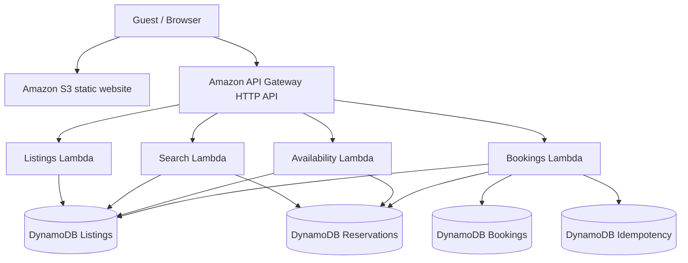

# StayFinder — Cloud-Based Accommodation Booking Platform

StayFinder is an Airbnb-inspired accommodation discovery and booking application built as an academic cloud-computing project. It combines a responsive frontend with listing, search, availability, and booking services, and explores multiple deployment approaches on AWS.

The project demonstrates service-oriented design, serverless application deployment, persistent data storage, booking correctness, containerized deployment, and controlled traffic experiments.

## Live serverless demo

- **Frontend:** [Open StayFinder](http://stayfinder-frontend-541165756574-1117143459.s3-website.ap-south-1.amazonaws.com)
- **API base URL:** [Open the API](https://gv1cw6q1p2.execute-api.ap-south-1.amazonaws.com/dev)
- **Health endpoint:** [/api/health](https://gv1cw6q1p2.execute-api.ap-south-1.amazonaws.com/dev/api/health)
- **Listings endpoint:** [/api/listings](https://gv1cw6q1p2.execute-api.ap-south-1.amazonaws.com/dev/api/listings)

The serverless demo uses the AWS Mumbai (`ap-south-1`) region. Public demo endpoints may be unavailable if the deployment is stopped or changed.

## Features

- Browse accommodation listings and search by destination.
- Filter stays and review listing details, photos, and amenities.
- Check availability and reserved dates.
- Create bookings and view booking status.
- Manage booking requests through protected manager operations in the integrated application.
- Compare and save stays, view itineraries, and use responsive layouts in the frontend.

The repository contains the integrated frontend/backend application as well as a separate AWS serverless implementation. Not every feature or workflow is necessarily identical across the two deployment paths.

## Architecture

### Deployed serverless architecture

The serverless implementation uses AWS SAM and AWS CloudFormation to define the application resources.



**Main AWS components**

| Component | Responsibility |
|---|---|
| Amazon S3 | Hosts the static frontend build |
| Amazon API Gateway HTTP API | Exposes the application API routes |
| AWS Lambda — Listings | Health checks and listing operations |
| AWS Lambda — Search | Searches listing inventory and reservation data |
| AWS Lambda — Availability | Checks availability and booked date ranges |
| AWS Lambda — Bookings | Creates, retrieves, and manages booking records |
| Amazon DynamoDB | Stores listings, bookings, reservations, and idempotency records |
| AWS SAM / CloudFormation | Defines and deploys the serverless resources |
| AWS IAM | Grants functions access to the DynamoDB tables they require |
| Amazon CloudWatch | Provides AWS function logs and monitoring data |

The infrastructure definition is in [`serverless/template.yaml`](serverless/template.yaml). The template configures Node.js 22 Lambda functions, an API Gateway HTTP API, and four on-demand DynamoDB tables. DynamoDB tables use server-side encryption; the idempotency table has a TTL attribute.

### Containerized Docker / EC2 architecture

The repository also includes a Docker-based application deployment path. The Docker Compose setup runs the frontend, backend API, and a persistent MongoDB replica-set database. The EC2 deployment work used an Ubuntu EC2 host with Docker Compose and a host-level Nginx entry point.

See:
- [Docker setup](DOCKER_SETUP.md)
- [Cloud architecture](CLOUD_ARCHITECTURE.md)
- [Booking concurrency](BOOKING_CONCURRENCY.md)

This is a separate deployment path from the S3 + API Gateway + Lambda + DynamoDB serverless deployment.

### Option B: prepared architecture, not deployed

The repository also contains an alternative EC2 + Application Load Balancer + Auto Scaling Group deployment design. It is documented as a prepared option, not as a deployed or measured AWS environment.

See [AWS deployment guide](AWS_DEPLOYMENT_GUIDE.md) and [architecture comparison](ARCHITECTURE_COMPARISON.md). Do not interpret the Option B design as evidence that an Auto Scaling Group or load balancer was created.

## Serverless performance experiments

The following results are from the recorded 30-second serverless tests dated 17 November 2026. The custom Node.js script sends read-only requests to `/api/health` and `/api/listings`; it does not exercise booking writes.

| Test run | Concurrent workers | Requests | Failed | Failure rate | Throughput | Average latency | P95 latency |
|---|---:|---:|---:|---:|---:|---:|---:|
| Normal | 5 | 154 | 0 | 0.00% | 5.13 req/s | 476.23 ms | 713.70 ms |
| Normal retest | 5 | 197 | 0 | 0.00% | 6.57 req/s | 259.70 ms | 498.82 ms |
| Holiday | 20 | 833 | 8 | 0.96% | 27.77 req/s | 222.70 ms | 652.35 ms |
| Holiday retest | 20 | 786 | 33 | 4.20% | 26.20 req/s | 256.05 ms | 728.25 ms |
| Holiday controlled | 8 | 369 | 0 | 0.00% | 12.30 req/s | 151.22 ms | 369.88 ms |

**How to interpret these results**

- These are short, controlled observations from the deployed serverless API, not a production capacity benchmark.
- The two 20-worker holiday runs recorded failures (0.96% and 4.20%). The 8-worker controlled run recorded no failures.
- The normal and holiday runs are separate observations; their latency values should not be treated as a controlled before/after experiment proving that higher concurrency improves latency.
- The script alternates between the health and listings endpoints and pauses each worker for 500 ms after a request.
- The recorded throughput is total requests divided by the configured test duration.
- Booking creation, concurrent reservation conflicts, and write-path throughput are not measured by this serverless read-only test script.

### Re-run the serverless test

Requirements: Node.js 22.14 or later and network access to the deployed API.

From the repository root:

```powershell
node .\load-testing\serverless-load-test.mjs 5 30 normal-manual
node .\load-testing\serverless-load-test.mjs 20 30 holiday-manual
```

Each run writes a JSON summary and a CSV request log into `load-testing/`. Use a distinct label for each run so existing evidence is not overwritten.

For the wider performance methodology, local Docker results, and evidence limitations, see [Load testing guide](LOAD_TESTING_GUIDE.md) and [Performance analysis](PERFORMANCE_ANALYSIS.md).

## Run locally

### Requirements

- Node.js 22.14 or later.
- npm.
- Docker Desktop with Docker Compose for the containerized setup.
- For manual backend setup, a MongoDB replica set; booking transactions require replica-set support.

### Recommended: Docker Compose

1. From the repository root, create a local environment file from the example:

   ```powershell
   Copy-Item .env.example .env
   ```

2. Set the required private environment values in `.env`. Do not commit secrets.

3. Start the application:

   ```powershell
   docker compose up --build
   ```

4. Open [http://localhost:8080](http://localhost:8080).

The Compose setup starts the frontend/API and a persistent local replica-set database. Follow [DOCKER_SETUP.md](DOCKER_SETUP.md) for seeding, configuration, and safe database handling.

### Manual frontend and backend setup

Consult the component-specific instructions before starting the services:

- [Backend README](backend/README.md)
- [Frontend README](frontend/README.md)

A typical manual setup uses separate terminals:

```powershell
cd backend
npm.cmd ci
if (!(Test-Path .env)) { Copy-Item .env.example .env }
npm.cmd run dev
```

```powershell
cd frontend
npm.cmd ci
if (!(Test-Path .env)) { Copy-Item .env.example .env }
npm.cmd run dev
```

The frontend development server is typically available at [http://localhost:5173](http://localhost:5173), with the backend at [http://localhost:5000](http://localhost:5000). Check the component READMEs for environment variables, database setup, seed commands, and test prerequisites. Do not run seed/reset commands against a database containing data you need to preserve.

## Testing and verification

The repository includes backend tests, frontend unit/API tests, browser tests, integration checks, and performance scripts. Exact commands and prerequisites are documented in:

- [Backend README](backend/README.md)
- [Frontend README](frontend/README.md)
- [Project audit](PROJECT_AUDIT.md)
- [Final demonstration guide](FINAL_DEMONSTRATION_GUIDE.md)

Historical test counts and results are recorded in the project documentation; they are snapshots from particular revisions and environments, not a guarantee that every test will pass on every machine.

## Security and project limitations

- Keep `.env` files, AWS credentials, manager tokens, and other secrets out of version control.
- The serverless SAM template accepts an admin API token as a protected parameter. Supply a strong secret during deployment; do not expose it in frontend build-time variables.
- The integrated academic booking workflow is not a complete commercial marketplace. Review the application documentation for the current authentication, authorization, payment, messaging, notification, and operational limitations before using it beyond a demonstration.
- Use sample guest information for demonstrations.
- AWS costs depend on usage, region, and resource configuration. Review the [cost estimation](COST_ESTIMATION.md) and deployment guides before creating or retaining chargeable resources.
- The performance figures above are not a cost benchmark, an availability guarantee, or evidence of sustained production capacity.

## Repository guide

| Path | Contents |
|---|---|
| `frontend/` | Browser application and frontend tests |
| `backend/` | Integrated application API and backend tests |
| `serverless/` | AWS SAM template, Lambda service code, and serverless tests |
| `load-testing/` | Serverless load-test script and recorded CSV/JSON results |
| `performance/` | Local performance evidence and analysis assets |
| `infra/` | Infrastructure templates and deployment-related files |
| `scripts/` | Project utility scripts |
| `member3-prototype/` | Earlier prototype work |

## Project documentation

- [Architecture comparison](ARCHITECTURE_COMPARISON.md)
- [Cloud architecture](CLOUD_ARCHITECTURE.md)
- [AWS deployment guide](AWS_DEPLOYMENT_GUIDE.md)
- [Docker setup](DOCKER_SETUP.md)
- [Booking concurrency](BOOKING_CONCURRENCY.md)
- [Load testing guide](LOAD_TESTING_GUIDE.md)
- [Performance analysis](PERFORMANCE_ANALYSIS.md)
- [Cost estimation](COST_ESTIMATION.md)
- [Project audit](PROJECT_AUDIT.md)
- [Final demonstration guide](FINAL_DEMONSTRATION_GUIDE.md)

---

**Project:** StayFinder — Airbnb-inspired SOA and cloud-computing application
**AWS region used for the serverless demo:** `ap-south-1` (Mumbai)
